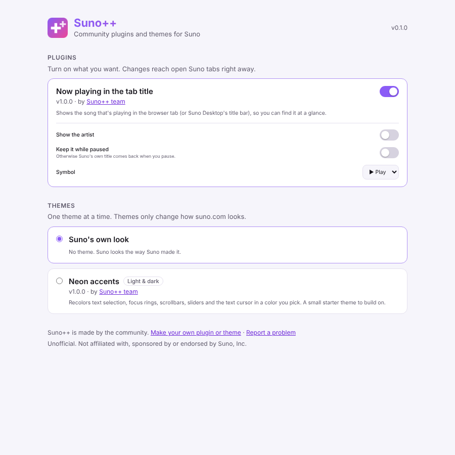

<div align="center">


# Suno++

**Community plugins and themes for [Suno](https://suno.com).**
In your browser, and in [Suno Desktop](https://github.com/Cat-things/suno-desktop).

[](https://github.com/Cat-things/sunoplusplus/actions/workflows/ci.yml)
[](LICENSE)
[](CONTRIBUTING.md)

<picture>
  <source media="(prefers-color-scheme: dark)" srcset="docs/images/options-dark.png" />
  
</picture>

</div>

> [!NOTE]
> Suno++ is an unofficial, community project. It is not affiliated with, sponsored by or endorsed by Suno, Inc.

## What it is

Suno++ adds things to suno.com that Suno doesn't (yet), and lets you restyle it:

- 🧩 **Plugins** add behavior: a now-playing tab title today, smarter style suggestions for the Create page next, and whatever the community comes up with.
- 🎨 **Themes** change how Suno looks: colors, spacing, a whole new vibe. Pick one, tweak its colors, switch back anytime.
- 🤝 **Made by the community.** Every plugin and theme is a folder in this repo. Anyone can add one with a pull request, and everything is reviewed before it ships.
- 🖥️ **Works in two places.** The same plugins and themes run in the browser extension (Chrome, Edge, Brave, Firefox) and inside Suno Desktop.

## Status

This is the **base** of Suno++: the plugin and theme formats, the SDK, the runtime, the browser extension, the Suno Desktop bundle, and one starter plugin and theme. It is not in the browser stores yet.

| Piece                                                 | State                                                                                                                              |
| ----------------------------------------------------- | ---------------------------------------------------------------------------------------------------------------------------------- |
| Plugin and theme formats, SDK, runtime                | ✅ Working, tested                                                                                                                 |
| Browser extension (Chrome, Edge, Brave, Firefox 128+) | ✅ Working, build from source or grab a CI build                                                                                   |
| Suno Desktop                                          | ✅ Built in from Suno Desktop's next release (Settings → Plugins); updates itself from Suno++ releases                             |
| Plugins in the catalog                                | 2: [Better Style recommendations](plugins/better-style-recommendations), [Now playing in the tab title](plugins/now-playing-title) |
| Themes in the catalog                                 | 1: [Neon accents](themes/neon-accents)                                                                                             |
| Chrome Web Store / Firefox Add-ons                    | 🔜                                                                                                                                 |
| Marketplace website                                   | ✅ [cat-things.github.io/sunoplusplus](https://cat-things.github.io/sunoplusplus/)                                                 |

**Browse everything in the [Suno++ Marketplace](https://cat-things.github.io/sunoplusplus/).**

## Try it

You need [Node.js](https://nodejs.org) 22.18+ and [pnpm](https://pnpm.io).

```sh
git clone https://github.com/Cat-things/sunoplusplus
cd sunoplusplus
pnpm install
pnpm build
```

Then load the extension:

- **Chrome, Edge, Brave:** open `chrome://extensions`, turn on **Developer mode**, click **Load unpacked** and pick `dist/extension/chrome`.
- **Firefox:** open `about:debugging#/runtime/this-firefox`, click **Load Temporary Add-on** and pick `dist/extension/firefox/manifest.json`.

Open suno.com, click the Suno++ icon in the toolbar and turn things on. Everything is **off until you turn it on**, and changes apply to open Suno tabs right away.

Prefer not to build? Every [release](https://github.com/Cat-things/sunoplusplus/releases/latest) has ready-to-load `sunoplusplus-chrome` and `sunoplusplus-firefox` zips.

**In Suno Desktop** there's nothing to install: open Settings → Plugins and turn on Suno++. The app downloads it and keeps it up to date by itself.

## Make your own

Got an idea? Make it real:

```sh
pnpm new plugin my-plugin   # or: pnpm new theme my-theme
pnpm dev                    # rebuilds while you edit
```

A plugin is a `manifest.json` and an `index.ts`:

```ts
import { definePlugin } from '@sunoplusplus/sdk'

export default definePlugin((ctx) => {
  ctx.onSongChanged((song) => ctx.log.info('now playing', song?.title))
  ctx.onRoute((route) => ctx.log.info('on', route.path))
})
```

A theme is a `manifest.json` and a `theme.css`. Settings and theme colors you declare in the manifest show up in the Suno++ settings automatically; you never write settings UI.

- 📘 [Making plugins](docs/PLUGINS.md)
- 🎨 [Making themes](docs/THEMES.md)
- 🤝 [Contributing](CONTRIBUTING.md): how to submit, and what reviewers check

No coding? Pitch ideas in Suno Desktop's Discussions: [Plugin ideas](https://github.com/Cat-things/suno-desktop/discussions/categories/plugin-ideas), [Theme ideas](https://github.com/Cat-things/suno-desktop/discussions/categories/theme-ideas).

## How it stays safe

Plugins and themes run on suno.com, where you're signed in, so Suno++ is strict about what they can do:

- **Reviewed code only.** Everything ships from this repo after review. The extension never downloads or runs code from anywhere else.
- **Only suno.com.** Plugins and themes can only target `https://suno.com/` pages, never other sites or sign-in pages.
- **No dependencies.** Plugins can import the SDK and files in their own folder, nothing else. The build enforces it.
- **Themes can't phone home.** No `@import`, no remote `url()`s, no CSS tricks that run code.
- **Isolated.** Plugins run in the extension's own JavaScript world, not Suno's, and one crashing plugin can't take down the others.
- **Tiny permissions.** The extension asks for `storage` and access to suno.com. That's it.

More in [SECURITY.md](SECURITY.md) and [docs/ARCHITECTURE.md](docs/ARCHITECTURE.md).

## Repository layout

```
plugins/<id>/        community plugins (manifest.json, index.ts, README.md)
themes/<id>/         community themes (manifest.json, theme.css, README.md)
packages/core/       manifest formats, URL matching, settings (shared)
packages/sdk/        what plugins import: definePlugin, the context API, DOM helpers
packages/runtime/    runs plugins and themes; browser and Suno Desktop hosts
packages/extension/  the browser extension: content script, popup, options page
packages/desktop/    the bundle Suno Desktop loads
scripts/             build, validate, scaffold
schemas/             JSON Schemas for manifest.json (editor autocomplete)
```

## Development

| Command                                      | What it does                                                                           |
| -------------------------------------------- | -------------------------------------------------------------------------------------- |
| `pnpm build`                                 | Builds the extension, desktop bundle and registry                                      |
| `pnpm dev`                                   | Same, rebuilding on changes                                                            |
| `pnpm validate`                              | Checks every plugin and theme the way CI does                                          |
| `pnpm test`                                  | Unit tests                                                                             |
| `pnpm test:e2e`                              | Loads the built extension in Chromium against a fake suno.com (`xvfb-run -a` on Linux) |
| `pnpm lint`, `pnpm typecheck`, `pnpm format` | The usual                                                                              |

## License

[MIT](LICENSE). Plugins and themes in this repo use MIT or another permissive license listed in [CONTRIBUTING.md](CONTRIBUTING.md#licenses).

Suno is a trademark of Suno, Inc. Suno++ is not affiliated with, sponsored by or endorsed by Suno, Inc.
